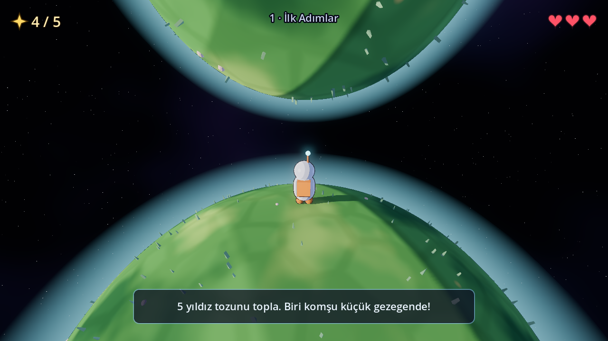

# Yörünge

> **English summary.** A small 3D platformer made with Godot 4.7 and GDScript: you walk around tiny planets, each with its own spherical gravity, collect five pieces of stardust per level and leave through a portal. Three hand-made tutorial levels plus a seed-based endless mode. No external assets: visuals are primitive meshes with custom shaders, and every sound is synthesised at startup.
> The rest of this README is in Turkish.



Godot 4.7 (Forward+, Jolt Physics, GDScript) ile yapılmış küçük bir 3B platform oyunu. Küçük gezegenlerde dolaşırsın; her gezegenin kendi küresel yerçekimi vardır. Her seviyede 5 yıldız tozu toplanınca çıkış portalı açılır.

## Özellikler

- Küresel yerçekimi ve gezegenler arası geçiş: başka bir gezegenin çekimine girince "yukarı" yumuşakça döner.
- 3 el yapımı tutorial seviyesi ve seed tabanlı sonsuz mod. Seviye üreticisi deterministiktir ve ürettiği seviyeyi doğrular.
- Dikenli toplar, 3 can, yeniden doğma; ana menü, duraklatma, ayarlar ve kayıt.
- Harici asset yok: görseller primitive mesh ve projenin kendi shader'ları (toon, dış hat, gezegen yüzeyi, atmosfer, yıldız alanı); sesler açılışta sentezlenir.
- DemoBot: oyunu kendi kendine baştan sona oynayıp rapor üreten uçtan uca test.

## Çalıştırma

[Godot 4.7](https://godotengine.org/) ile `project.godot` dosyasını aç ve oynat, ya da komut satırından:

```bash
godot --path .
godot --path . -- --demo     # DemoBot oynasın
```

## Kontroller

| Eylem | Klavye ve fare | Oyun kolu |
|---|---|---|
| Hareket | W A S D ya da ok tuşları | Sol çubuk |
| Kamera | Fare | Sağ çubuk |
| Zıplama | Boşluk | A |
| Duraklatma | Esc ya da P | Start |

## Test

```bash
godot --headless --path . --script res://tests/run_tests.gd
```

2026-11-25'te Godot 4.7.2 ile: 1831 denetim, 0 hata. Uçtan uca demo koşusu:

```bash
godot --headless --path . --fixed-fps 60 --quit-after 120000 -- \
  --demo --demo-exit-on-finish --fresh-save --endless-levels=5 --endless-seed=2026
```

Geliştirme günlüğü, ölçümler ve her kilometre taşında neyin doğrulandığı [PROGRESS.md](PROGRESS.md) dosyasında. Kilometre taşları `m0`–`mi` etiketleriyle işaretli.

## Dizin düzeni

| Klasör | İçerik |
|---|---|
| `gravity/`, `player/`, `camera/` | Yerçekimi çözümleyici, oyuncu denetimi, yörünge kamerası |
| `world/`, `levels/` | Gezegenler, toplanabilirler, seviye tanımı, üretici ve kurucu |
| `shaders/`, `vfx/`, `audio/` | Shader'lar, parçacıklar, ses sentezi |
| `ui/`, `main/`, `autoload/` | Menüler, ekran akışı, kayıt |
| `ai/`, `debug/`, `tests/` | DemoBot, ölçüm sahneleri, testler |
| `addons/beckett/` | Üçüncü taraf editör eklentisi (aşağıya bak) |

## Lisans

[MIT](LICENSE). `addons/beckett/` ayrı bir projedir ([Beckett](https://github.com/beckettlab/beckett-godot-mcp)) ve kendi MIT lisansını taşır.
